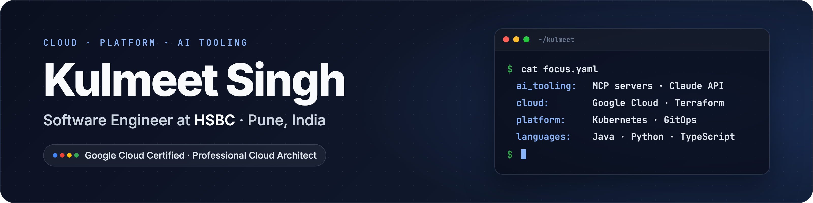
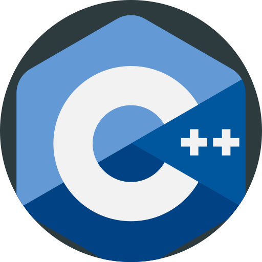
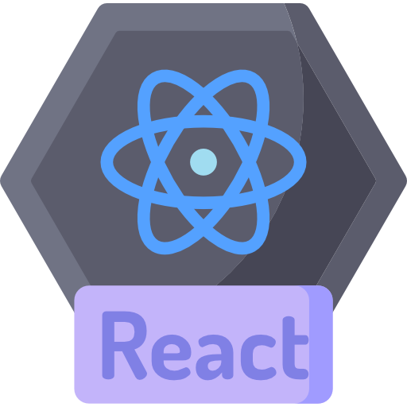
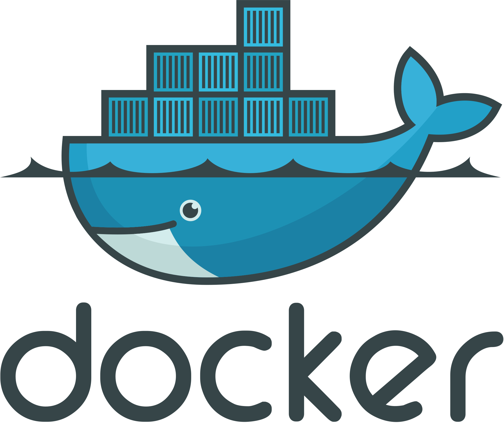
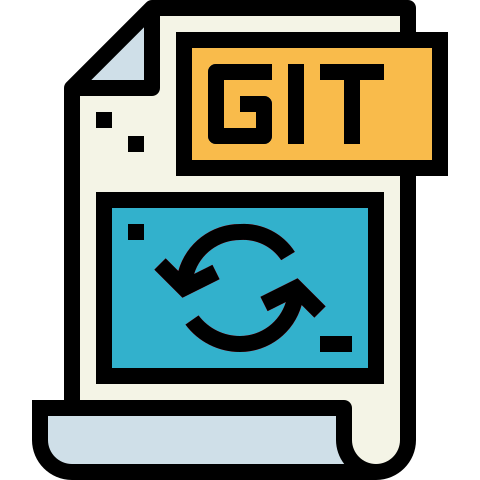

<h1 align="center">
  
</h1>

<h1 align="center">
  Hi , I'm Kulmeet Singh
</h1>

  <b>Software Engineer at HSBC | GCP Data & Platform Engineering | Google Cloud Certified Professional Cloud Architect</b>

  2+ years building payment-data pipelines and GCP infrastructure on HSBC's Payments Data Platform team in Pune, India.
   
  Open to <b>GCP data, platform and cloud engineering roles</b> in India (Pune, Bengaluru, Hyderabad, Mumbai or remote).

---

##  About Me

**At HSBC (Payments Data Platform, Pune)**

- ⚙️ Build and maintain **Java Apache Beam pipelines on Google Cloud Dataflow** (Pub/Sub → BigQuery). The real-time pipeline handles **10M+ daily payment transactions at 99.9% uptime**.
- 🏗️ Author and use reusable **Terraform** to manage GCP infrastructure (Pub/Sub, BigQuery, GCS, IAM) across **2,000+ resources**.
- 💰 Reduced **Dataflow compute cost by ~30%** (an estimated **$150K+ annually**) through automation and optimization.
- 🤖 Built **MCP diagnostic servers** in Python with the **Claude API** and Google ADK, cutting manual troubleshooting by **~70%**.
- 🚨 Configured **Cloud Monitoring alerting policies**, improving incident detection and MTTR by **~40%** for the monitoring and incident-response workflow.

**Outside work:** I build delivery, reliability and infrastructure-as-code projects and measure them. They're listed below.

---

##  Featured Projects

> Personal projects. Every number is a personal benchmark (a laptop, a local kind cluster or a sandbox GCP project), not an HSBC or production result.

| Project | What it is | Results | Stack |
|---|---|---|---|
| **[PayFlow Sim](https://github.com/KulmeetSJ/payflow-sim)** | Event-driven payments simulator on synthetic data: idempotent processing, per-account ordering, retry topics and a dead-letter topic with replay. OpenTelemetry tracing and SLO burn-rate alerts, tested with promtool in CI. Load-tested with k6, then broken on purpose with chaos experiments and a blameless postmortem of the induced fault. | **0 accepted payments lost** across 3 chaos runs (broker kill, consumer kill, +500 ms DB latency) Postmortem fixes cut time-to-page from **~51 min (projected) to 11.3 min** and DB round trips from **8 to 4** k6 load-test knee at **750–1,000 payments/s** with 3 processors (laptop-bound, relative) *Laptop benchmark, synthetic data.* | Java 21, Spring Boot, Kafka, PostgreSQL, OpenTelemetry, Prometheus, Grafana, k6, Toxiproxy |
| **[GitOps Delivery Platform](https://github.com/KulmeetSJ/gitops-demo-platform)** ([app repo](https://github.com/KulmeetSJ/gitops-demo-app)) | A Spring Boot API released dev → staging → prod through pull-based GitOps. Canaries are judged on live Prometheus metrics, policies are enforced at admission, and CI is gated by an image scan. | **~17 min** median commit to prod (excluding the approval wait) Canary rolled back **30 s** after the first failed metric-analysis check (**5/5** drills) **7/7** non-compliant manifests blocked *Local kind cluster.* | Argo CD, Argo Rollouts, Kyverno, GitHub Actions, Trivy, Helm |
| **[Terraform Drift Detector](https://github.com/KulmeetSJ/tf-drift-detector)** | Scheduled drift detection for GCP in GitHub Actions. It separates real drift from unapplied code, catches IAM grants Terraform doesn't manage, and keeps one self-closing GitHub issue. Keyless auth via Workload Identity Federation. | **7/7** console-style changes detected, median **26 s** from change to issue **on a manual run** *Sandbox GCP project.* | Terraform, GCP, GitHub Actions, Conftest/Rego, Python |
| **[GuruGranthi](https://gurugranthisewa.com/)** 🟢 *Live* | Services marketplace and booking platform for Sikh service providers: provider applications and listings, booking requests, an admin portal, and role-based access. | Built and launched; live at [gurugranthisewa.com](https://gurugranthisewa.com/). *Repo is private.* | Next.js, TypeScript, Supabase, PostgreSQL (Row Level Security) |

---

##  Tech Stack

  &nbsp;
  &nbsp;
  &nbsp;
  &nbsp;
  &nbsp;
  &nbsp;
  &nbsp;
  &nbsp;
  &nbsp;
  &nbsp;
  &nbsp;
  &nbsp;
  &nbsp;
  &nbsp;
  &nbsp;
  &nbsp;
  

- **Languages & frameworks:** Java · Python · SQL · TypeScript · JavaScript · C++ · Bash · Spring Boot · React
- **Data & Cloud:** GCP: Apache Beam / Dataflow, BigQuery, Pub/Sub, GCS, Cloud Composer (Airflow), Spanner, Bigtable, IAM · PostgreSQL · Kafka (CDC topic configuration at work; producer/consumer engineering†)
- **Infra & Delivery:** Terraform · Kubernetes / GKE (workloads and manifests) · Helm · Docker · Jenkins · Ansible · CI/CD with SonarQube, Checkmarx and Nexus scans · Cloud Monitoring · Cloud Logging · Grafana · GitHub Actions† · Argo CD† · Argo Rollouts† · Kyverno† · Trivy† · Conftest/Rego† · OpenTelemetry† · Prometheus†
- **AI tooling:** MCP servers (Python) · Claude API · Google ADK · Claude Code · Gemini · GitHub Copilot

† Used in personal projects only.

---

##  Certifications

- **Google Cloud Certified Professional Cloud Architect**
- **Wipro Java Full Stack Certification**

---

##  Currently Building

- My portfolio site and some job-search tooling.

---

##  Let's Connect

  <a href="mailto:singhkulmeet3@gmail.com">
    &nbsp;
  </a>
  <a href="https://www.linkedin.com/in/kulmeet-singh/">
    &nbsp;
  </a>

  🌐 <a href="https://portfolio-one-ashen-c8e7anc8i0.vercel.app/">Portfolio</a> &nbsp;·&nbsp;
  🟢 <a href="https://gurugranthisewa.com/">GuruGranthi (live)</a>

  Coding profiles:
  <a href="https://leetcode.com/u/Kulmeet/">LeetCode</a> ·
  <a href="https://www.geeksforgeeks.org/profile/singhkulmeet3">GeeksforGeeks</a>

